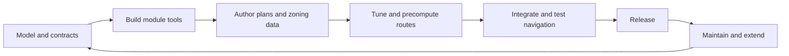

# Implementation plan

This plan sequences development of the plan tracer, zoning, routing, and navigation modules. Their requirements and data contracts are defined in the module specifications and file-format specification.

## Development lifecycle

## Phases

Ordered by dependency; each phase provides inputs to the next.

1. **Plan tracer.** Produce and maintain a plan SVG for each floor from the architectural plans. Validate drawing, saving, and reopening against the plan-tracer specification.
2. **Zoning module.** Build the zoning editor around the zoning file and plan SVG. Support model editing, checks, approval and checkpoints, and generation of the zone SVG, connectivity graph JSON, and Navigation SVG from an explicitly selected finalized version.
3. **Routing module.** Build the tuning editor, graph compiler, and route computer. Consume the connectivity graph and zone SVG; support costs and routing variants; produce the routing graph and precomputed routes dataset.
4. **Navigation module.** Consume the Navigation SVG and precomputed routes dataset; resolve user input to navigable zones, select a route, and display it with instructions.
5. **Integration and testing.** Verify each module's file contracts and behavior independently, then test complete flows with controlled fixtures and verified building data. Keep algorithm tests distinct from interface compatibility tests.

## Development criteria

- Generated zoning outputs identify the finalized zoning-file version from which they derive.
- Plan and route geometry use compatible coordinate frames.
- Routing variants only narrow the available graph.
- Route selection minimizes total distance and additional costs.
- Tests cover reachable and unreachable queries, zone restrictions, file compatibility, and route rendering.

## Future direction

These ideas are not yet detailed enough to be phases:

- **Facility coverage.** Extend the proven asset and compiler pipeline to the complete building.
- **Adjacency graph.** Interpret architectural plans into a machine-readable adjacency graph.
