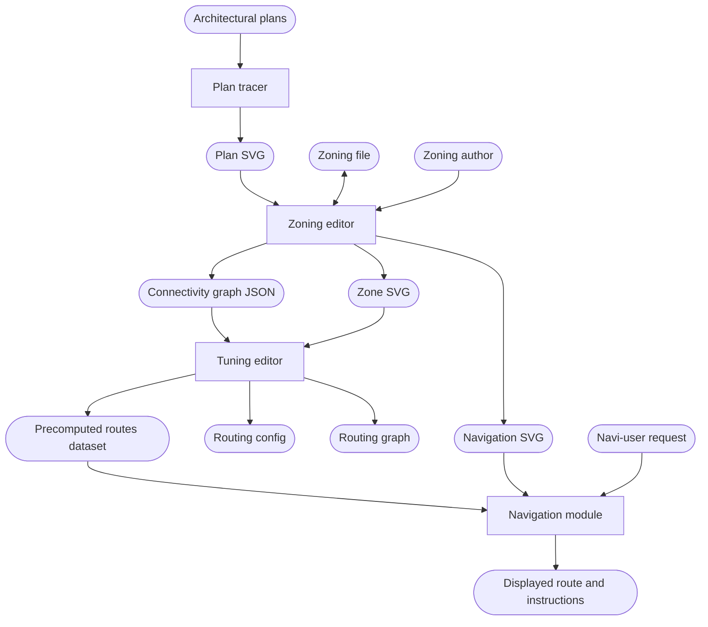

# System design

The rulebook defines the conceptual model. The module specifications describe the zoning, routing, and navigation modules; the file-format specification defines their shared file representations.

## System overview

Plan tracing, zoning, routing, and navigation form a sequence of independent modules. The zoning author produces a finalized building model and generated assets; the routing module tunes and precomputes routes; the navigation module serves a navi-user from those assets.

## Zoning module

The plan tracer is a drawing application for producing a plan SVG from architectural plans. The zoning editor uses the plan SVG as its reference underlay and maintains the building model in a zoning file.

The zoning editor holds the work in a zoning working view with a reference underlay, an approved baseline, and a working overlay. The zoning author explicitly approves edits and establishes checkpoints. A finalized version is the approved baseline at the latest checkpoint.

The zoning editor generates the zone SVG, connectivity graph JSON, and Navigation SVG only when the zoning author selects a finalized version and commands generation. All three outputs identify the zoning-file version from which they were generated.

## Routing module

The tuning editor takes the connectivity graph and zone SVG. It contains the graph compiler and route computer, so tuning and route computation take place in the same module.

The editor starts with an empty routing configuration. The graph compiler derives a routing graph from the connectivity graph and configuration; the route computer computes routes from that graph. The zoning author adjusts state and segment costs and variant-specific zone restrictions and reviews the resulting routes on the zone SVG. The module saves the routing configuration, routing graph, and precomputed routes dataset.

## Navigation module

The browser client uses the Navigation SVG and precomputed routes dataset. It resolves the navi-user's start and target to navigable zones, looks up the route for the selected variant, and displays the route with instructions. A lookup may find that no route is available.

The Navigation SVG and displayed route geometry share a coordinate frame. The client uses a built dataset and plan and cannot track the navi-user's real-time position.
